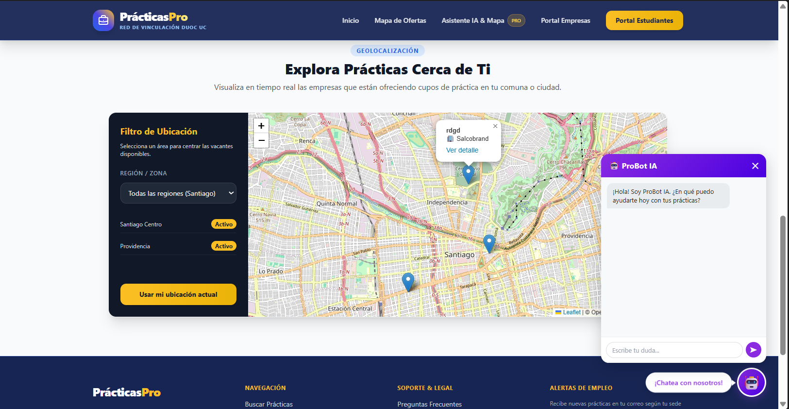

# PrácticasPro

[](https://practicaspro.onrender.com)


Plataforma web de vinculación laboral y geolocalización de prácticas profesionales para estudiantes de **Duoc UC**. Integra herramientas de inteligencia artificial para orientación vocacional, redacción de cartas de presentación y revisión de currículums.

**Entorno en producción:** [https://practicaspro.onrender.com](https://practicaspro.onrender.com)

---

## Vista General



---

## Funcionalidades

- **ProBot IA:** Asistente conversacional basado en **Google Gemini (`gemini-3.8-flash`)** orientado a resolver consultas sobre procesos de práctica, entrevistas técnicas y empleabilidad.
- **Asistente de CV y Cartas:** Módulo de análisis de perfil que genera cartas de presentación personalizadas y sugiere palabras clave y mejoras de redacción según la carrera y el cargo objetivo.
- **Tolerancia a Fallos en API:** Rotación automática entre múltiples claves de API con control estricto de tiempos de espera HTTP para evitar bloqueos de workers ante límites de cuota (`429`) o latencia externa (`504`).
- **Mapa Interactivo de Ofertas:** Visualización georreferenciada de vacantes mediante **Leaflet.js** y cartografía **CARTO Voyager**.
- **Gestión de Usuarios y Roles:** Autenticación diferenciada para estudiantes y empresas sobre **Firebase Authentication** y persistencia en **Cloud Firestore**.

---

## Arquitectura y Tecnologías

| Componente | Tecnología |
| :--- | :--- |
| **Backend** | Python 3.12, Django 6.1.1, Gunicorn |
| **Inteligencia Artificial** | Google GenAI SDK (`google-genai`), `gemini-3.8-flash` |
| **Base de Datos y Auth** | Firebase Authentication, Cloud Firestore |
| **Frontend** | HTML5, Tailwind CSS, JavaScript ES6+, Leaflet.js |
| **Servicios Cartográficos** | CARTO Voyager Basemaps / OpenStreetMap |
| **Infraestructura** | Render Cloud |

---

## Instalación Local

### 1. Clonar el repositorio

```bash
git clone [https://github.com/tomasPozoo/Pr-cticasPro.git](https://github.com/tomasPozoo/Pr-cticasPro.git)
cd Pr-cticasPro